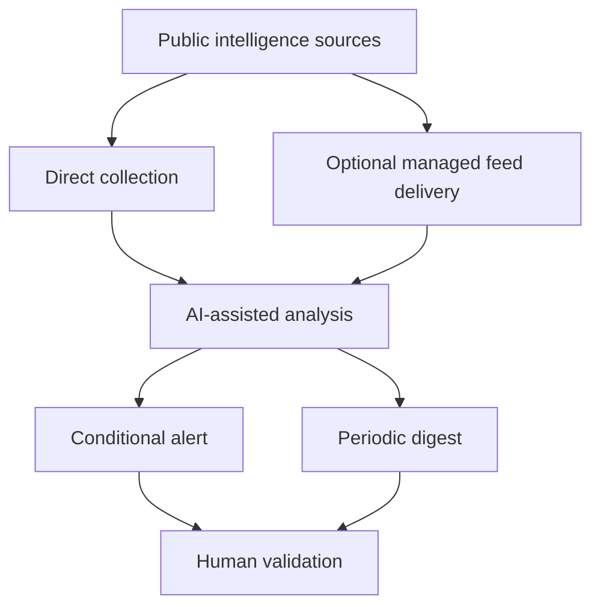

# Agentic Cyber Intel

A vendor-neutral reference architecture for AI-assisted cybersecurity intelligence using managed scheduling, public information sources and human-led triage.

**v1.0 RC2 — pending maintainer review.**

Security teams face a high volume of advisories with uneven evidence and operational relevance. This project describes a configurable approach to collecting, correlating and presenting public security intelligence without requiring a user-managed application runtime.

## Start here

1. Understand the [architecture](docs/architecture.md) and [intelligence model](docs/intelligence-model.md).
2. Explore the [illustrative configuration](config/examples/README.md) and [worked prompt examples](prompts/examples/README.md).
3. Use the [personalization guide](docs/personalization-guide.md) to build your own private profile.
4. Follow the [deployment guide](docs/deployment-guide.md) and [validation plan](validation/acceptance-tests.md).

The existing empty configuration templates and parameterized prompts are starting points for private customization. The populated examples are independently constructed teaching material, not actual inventories, source selections, priorities or monitoring schedules. Do not deploy them unchanged. Configuration is descriptive, not an executable integration.

This framework works best when you tailor relevance, source selection, alert criteria, evidence policy, cadence and delivery to your needs. Managed services may require subscriptions, supported integrations and permissions. This is documentation, not executable software, a vulnerability database or a guaranteed detection service. Human validation is required before action.

See [security and privacy](SECURITY.md), [limitations](docs/limitations.md) and [MIT license](LICENSE).
