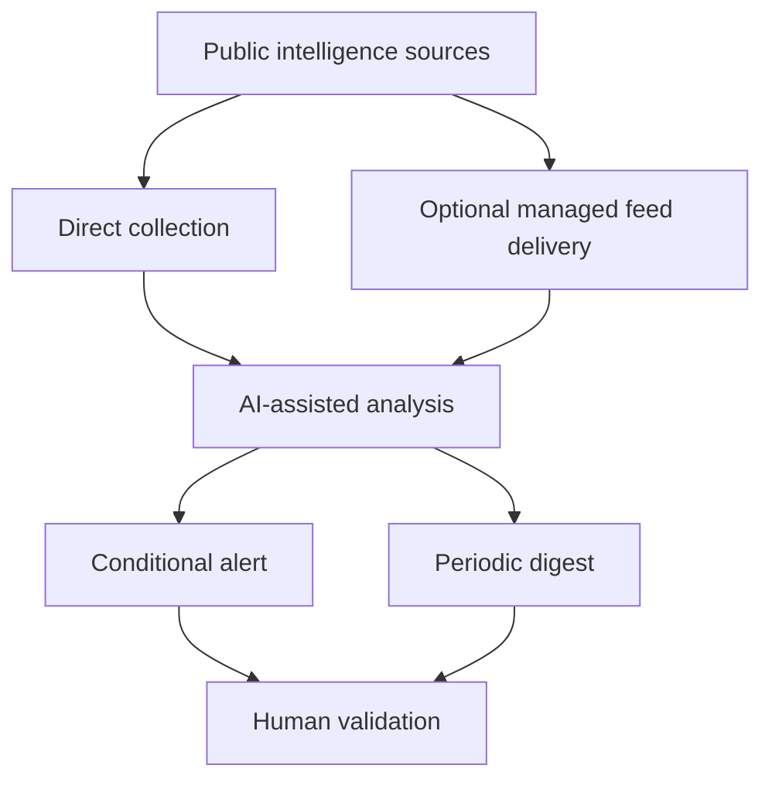

# Agentic Cyber Intel

A vendor-neutral reference architecture for AI-assisted cybersecurity intelligence using managed scheduling, public information sources and human-led triage.

**Public-release candidate v1.0 — pending maintainer review.**

## Concept

Security teams face a high volume of advisories with uneven evidence and operational relevance. This project describes a configurable approach to collecting, correlating and presenting public security intelligence without requiring a user-managed application runtime.

## Start here

- [Architecture](docs/architecture.md)
- [Deployment guide](docs/deployment-guide.md)
- [Evidence and relevance models](docs/intelligence-model.md)
- [Security and privacy](SECURITY.md)
- [Prompt templates](prompts/shared-policy.md)
- [Validation plan](validation/acceptance-tests.md)

The templates are illustrative and do not describe any actual organization, asset inventory, deployment, monitoring schedule or source selection. Supply your own configuration privately. Managed services may require subscriptions, supported integrations and permissions.

This is documentation, not executable software, a vulnerability database, or a guaranteed detection service. Human validation is required before action.

[MIT license](LICENSE).
