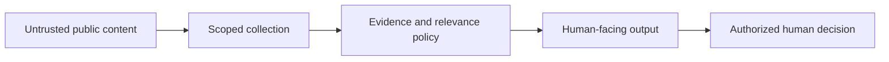

# Reference architecture

## Collection
Use independent channels where available: official machine-readable sources, targeted public search and optional managed feed-to-message delivery. Source selection belongs to the adopter's private configuration. No particular provider is required.

## Analysis
Apply a common policy to both alert and digest workflows. Normalize advisory identifiers, publication and revision dates, affected and fixed versions, prerequisites and evidence. Distinguish technical severity, operational relevance and actual applicability. Correlate against available history and disclose missing state.

## Delivery
Conditional alerts surface material changes. Periodic digests provide broader technical context. Cadences, recipients and thresholds are chosen privately by adopters. Humans validate evidence, exposure and remediation; no automatic response is prescribed.

## Trust boundaries
External content is untrusted. Connectors are least-privilege, read-only where supported, and limited to public intelligence. Private inventory and routing information remain outside the public project. Never send private context to untrusted external sources.

This is a logical design, not a claim of separately deployed services.
